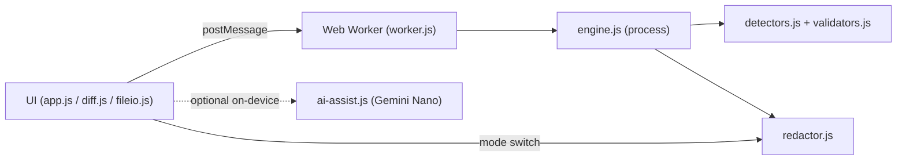

# RedactLocal

> **Browser-only PII sanitization — nothing leaves your device.**

[](https://github.com/user/redactlocal/actions)


## Live Demo

- **Firebase Hosting (Recommended — full security headers):** `https://redactlocal-demo.web.app`
- **GitHub Pages:** `https://<username>.github.io/redactlocal/`

## 30-Second Quick Start

```bash
git clone https://github.com/<username>/redactlocal.git
cd redactlocal
npm install        # dev tooling only (ESLint, Playwright, axe-core) — zero runtime deps
npm start          # serves on http://localhost:8080 with strict security headers
```

Click **Load Sample Text** to test all 7 entity types, switch between **Full / Partial / Pseudo** modes, and click **Download Sanitized**.

---

## Requirements → Implementation

| Brief Requirement | Feature | File | Test |
|---|---|---|---|
| 100% browser-only, zero network calls | Strict CSP (`default-src 'none'`), zero runtime deps, offline PWA | `index.html`, `sw.js` | `tests/security.test.js`, `tests/e2e/security.spec.js` |
| Detect 7 PII types + checksums | Luhn (cards), Verhoeff (Aadhaar), IPv4/IPv6, PAN, Email, Phone | `js/validators.js`, `js/detectors.js` | `tests/validators.test.js`, `tests/detectors.test.js` |
| 3 Redaction modes | Full (`[REDACTED]`), Partial (`XXXX...`), Pseudo (`USER_01`) | `js/redactor.js` | `tests/redactor.test.js`, `tests/engine.test.js` |
| Side-by-side diff & counts | Line-aligned diff, synced scroll, hover-link, live counts | `js/diff.js`, `js/app.js` | `tests/e2e/app.spec.js` |
| File upload & CSV safety | `.txt`/`.csv` ≤ 5 MB, NUL-byte reject, RFC 4180 formula neutralization | `js/fileio.js`, `js/csv.js` | `tests/fileio.test.js`, `tests/csv.test.js` |
| Accessibility (WCAG 2.2 AA) | Skip link, ARIA live regions, keyboard flow, high contrast | `index.html`, `css/styles.css` | `tests/e2e/a11y.spec.js` |
| Efficiency (Web Worker) | Off-main-thread detection, 250 ms debounce, chunked diff | `js/worker.js`, `js/diff.js` | `tests/performance.test.js` |
| Privacy-preserving Google tech | On-device Gemini Nano, Firebase Hosting, Lighthouse CI, MD3, PWA | `js/ai-assist.js`, `firebase.json` | `tests/ai-assist.test.js` |

See [REQUIREMENTS.md](./REQUIREMENTS.md) for the complete traceability matrix.

---

## Detection Rules

| Entity Type | Pattern / Rule | Validation & Normalization |
|---|---|---|
| `EMAIL` | Standard local@domain.tld with word boundaries | Normalized to lowercase |
| `PHONE` | Indian (`+91`/`0` + `[6-9]\d{9}`), US (`(555) 123-4567`, `555-123-4567`), International (`+CC ...`) | 7–15 digits; normalized to last 10 digits |
| `IPV4` | Dotted quad `\d{1,3}(\.\d{1,3}){3}` | Each octet `0–255`, no leading zeros |
| `IPV6` | Full 8-group and `::`-compressed forms | `isValidIPv6()`; normalized to expanded lowercase |
| `PAN` | `[A-Z]{3}[PCHFATBLJG][A-Z]\d{4}[A-Z]` | 4th char entity-type check; normalized to uppercase |
| `AADHAAR` | `[2-9]\d{3}([\s\-]?)\d{4}\2\d{4}` | Verhoeff checksum (`high` vs `medium` confidence; `strictAadhaar` drops `medium`) |
| `CARD` | 13–19 digits with optional spaces/dashes | **Luhn checksum required**; IIN brand tagged (`visa`, `mastercard`, `amex`, `rupay`, `discover`) |

**Overlap resolution:** Longest span wins; ties break by `CARD > AADHAAR > PAN > EMAIL > IPV6 > IPV4 > PHONE`.

---

## Redaction Mode Examples

Given input: `Contact John.Doe@Example.com, john.doe@example.com, +91 98765 43210, card 4111 1111 1111 1111`

| Mode | Output |
|---|---|
| **Full** | `Contact [REDACTED], [REDACTED], [REDACTED], card [REDACTED]` |
| **Partial** | `Contact J***@Example.com, j***@example.com, +XX XXXXX X3210, card XXXX XXXX XXXX 1111` |
| **Pseudo** | `Contact USER_01, USER_01, PHONE_01, card CARD_01` |

---

## Architecture



---

## Google Services (Privacy-Preserving)

1. **Chrome Built-in AI — Gemini Nano (`js/ai-assist.js`):** Optional on-device detection for `PERSON` and `ADDRESS` entities using Chrome's local `LanguageModel` API. Runs 100% on-device — zero text is sent to Google. Gracefully degrades to regex-only in other browsers.
2. **Google Firebase Hosting (`firebase.json`):** Recommended production deploy because Firebase serves strict HTTP security headers (`Content-Security-Policy` with `frame-ancestors 'none'`, `Strict-Transport-Security`, `X-Frame-Options: DENY`) that static-only hosts like GitHub Pages cannot set via HTTP headers.
3. **Google Lighthouse CI (`lighthouserc.json`):** Enforces Performance ≥ 95, Accessibility = 100, Best Practices ≥ 95, SEO ≥ 90.
4. **Material Design 3 (`css/styles.css`):** MD3 color, shape, elevation, and type scale tokens using system fonts (no remote Google Fonts).
5. **PWA (`manifest.webmanifest`, `sw.js`):** Cache-first app shell for full offline operation.

> **Why not Google Analytics, reCAPTCHA, Google Fonts, or Cloud Gemini API?** Any of those would transmit user data or metadata to external servers, violating RedactLocal's core "nothing leaves your browser" guarantee.

---

## Security Model

- **Zero network requests** after initial page load (verified in Playwright E2E).
- **Strict CSP** with `require-trusted-types-for 'script'` and `default-src 'none'`.
- **No unsafe DOM sinks** (`innerHTML`, `eval`, `document.write` banned by ESLint & static security tests).
- **CSV formula injection defense** (`=`, `@`, `\t`, `\r`, `+`/`-` non-digit prefixed with `'`).
- **No persistence of raw PII** (`localStorage` used solely for `redactlocal-theme`).

See [SECURITY.md](./SECURITY.md) for the full threat model.

---

## Accessibility

- WCAG 2.2 AA compliant (0 axe-core violations across empty, loaded, all modes, dark theme, and error states).
- Skip link (`#skip-link`), semantic landmarks (`header`, `main`, `footer`), `aria-live="polite"` status and stats announcements.
- Full keyboard navigation, visible focus rings, 320 px / 200% zoom support, `prefers-reduced-motion` support, and non-color-only entity distinction (icons + labels).

---

## Efficiency

Measured on Node 24 (`tests/performance.test.js`):
- **1 MB mixed text (`detect` + all 3 `redact` modes):** **~116 ms** (budget: < 1500 ms)
- **1 MB mode switch (`redact` only, reusing cached entities):** **~91 ms** (budget: < 300 ms)
- **O(N log N) overlap resolution**, single-pass O(N) redaction, 250 ms input debounce, `requestAnimationFrame` chunked diff rendering (> 200 KB), and Web Worker offloading.

---

## How to Run Tests

```bash
npm run lint           # ESLint (0 errors, 0 warnings)
npm test               # Unit, security, fileio, ai-assist, performance tests
npm run test:coverage  # Unit tests with >= 90% line & function coverage check
npm run test:e2e       # Playwright functional, security, and axe-core a11y tests
npm run check:size     # Verify repo size < 10 MB
npm run test:all       # Run lint + coverage + E2E
```

---

## Design Decisions

- **Overlap priority:** Longer span wins; ties resolve as `CARD > AADHAAR > PAN > EMAIL > IPV6 > IPV4 > PHONE` so digit-containing emails or 16-digit cards are never misclassified as phone numbers or Aadhaar.
- **Aadhaar confidence:** Verhoeff-valid numbers get `confidence: 'high'`; Verhoeff-invalid 12-digit numbers starting with `2–9` get `'medium'` (toggleable via `strictAadhaar`). Consistent separator backreference prevents ticket IDs like `20240315-0042` from false-matching.
- **CSV neutralization:** Cells starting with `=`, `@`, `\t`, `\r`, or `+`/`-` followed by a non-digit are prefixed with `'`, leaving negative numbers (`-42`) and phone numbers (`+91...`) intact.

## Limitations

- Regex-based detection focuses on structured PII (Email, Phone, IP, PAN, Aadhaar, Card); unstructured names/addresses require Chrome's on-device Gemini Nano (`toggle-ai-assist`).
- Service Worker offline caching requires HTTPS or `localhost`.

---

- [Prompt Log (PROMPT_LOG.md)](./PROMPT_LOG.md)
- [Requirements Matrix (REQUIREMENTS.md)](./REQUIREMENTS.md)
- [Security Policy (SECURITY.md)](./SECURITY.md)
